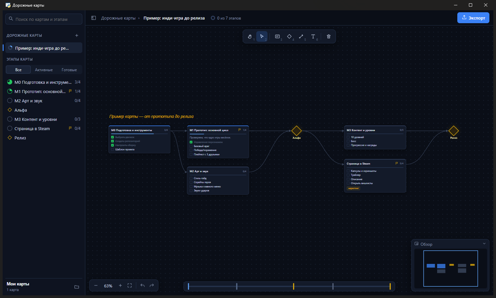

<p align="center"></p>

<h1 align="center">Дорожные карты</h1>

<p align="center">Настольное приложение для Windows: дорожные карты проектов на бесконечном холсте —<br>
карточки этапов с задачами, вехи, стрелки зависимостей. Карты можно составлять вместе с ИИ (Claude, ChatGPT и др.).</p>



## Возможности

- **Карты и этапы** — список карт слева с прогрессом, этапы с фильтром «Все / Активные / Готовые» и поиском.
- **Холст** — масштаб колёсиком, перетаскивание карточек, стрелки «что за чем идёт», вехи-ромбы, текстовые подписи.
- **Задачи** — отмечаются прямо на карточке, прогресс считается сам.
- **Мини-карта и таймлайн** — быстрый переход к любому этапу.
- **Отмена/повтор** (Ctrl+Z / Ctrl+Y), горячие клавиши инструментов 1–6.
- **Экспорт** в Markdown и PNG.
- **Обычные файлы** — каждая карта это один `.json` в папке `roadmaps/`. Изменили файл — приложение подхватит его за секунду
  и подсветит изменившиеся этапы.
- **Замок** (L) — карточки перестают двигаться и редактироваться, можно только отмечать задачи. Удобно для ежедневной работы.
- **Для программистов:**
  - ссылки в задачах: `https://…` и пути к коду `src/app.py:120` — клик открывает файл в редакторе на нужной строке
    (VS Code, Cursor, Notepad++ или Блокнот);
  - кнопка «TODO» собирает комментарии `TODO / FIXME / HACK` из папки проекта в задачи;
  - блокировки: этап с незакрытыми предыдущими помечен замком; «Крит. путь» (K) подсвечивает самую длинную цепочку работы;
  - круговые связи (этапы ждут друг друга) подсвечиваются красным.
- **Приятные мелочи** — конфетти за закрытые этапы, поток по стрелкам к текущим этапам, быстрая задача «+»,
  справка по клавишам (?). Анимации выключаются кнопкой-звёздочкой.

## Установка

**Вариант 1 — готовая программа.** Скачайте `Roadmaps.zip` в разделе [Releases](../../releases), распакуйте и запустите `Roadmaps.exe`.
Нужна Windows 10/11 (компонент Edge WebView2 там уже есть). Карты хранятся в папке `roadmaps` рядом с программой.

**Вариант 2 — из исходников** (нужен Python 3.10+):

```bash
python -m venv .venv
.venv\Scripts\pip install -r requirements.txt
.venv\Scripts\python app.py
```

Дальше можно запускать двойным кликом по `Запустить.bat`.

## Управление

| Действие | Как |
|---|---|
| Двигать холст | тянуть пустое место, или рука (1 / H), или пробел + мышь |
| Масштаб | колёсико мыши, «Показать всё» — F |
| Новый этап / веха / текст | инструменты 3 / 4 / 6, затем клик по холсту (или двойной клик по пустому месту) |
| Связать этапы | инструмент 5, клик по первому этапу, потом по второму |
| Редактировать этап | двойной клик по карточке или Enter |
| Удалить | Delete |
| Быстро добавить задачу | наведите на карточку и нажмите «+» |
| Закрепить карту (замок) | L или кнопка с замком в панели |
| Критический путь | K |
| Справка по клавишам | ? или F1 |

## Карты с помощью ИИ

Формат карты простой, его понимает любая нейросеть. Попросите, например:
«Составь дорожную карту запуска моей игры в формате ниже» — и сохраните ответ как `roadmaps/моя-карта.json`.
Если вы работаете с [Claude Code](https://claude.com/claude-code) в папке приложения, он прочитает `CLAUDE.md`
и будет сам создавать и обновлять карты.

```json
{
  "title": "Запуск игры",
  "stages": [
    { "id": "proto", "title": "M1 Прототип", "tasks": ["[x] Управление", "Враги", "Плейтест"] },
    { "id": "art", "title": "M2 Арт", "after": ["proto"], "tasks": ["Стиль-гайд", "Спрайты"] },
    { "id": "alpha", "title": "Альфа", "type": "milestone", "after": ["art"] }
  ]
}
```

- `after` — после каких этапов идёт этот (рисуются стрелки);
- `type: "milestone"` — веха-ромб;
- координаты `x`, `y` указывать не нужно — приложение разложит этапы само.

Полное описание формата — в [CLAUDE.md](CLAUDE.md).

## Сборка .exe

```bash
build.bat
```

Готовая программа появится в `dist/Roadmaps`. Также сборку делает GitHub Actions: при создании тега вида `v1.0.0`
архив автоматически прикрепляется к релизу.

## Технологии

Python + [pywebview](https://pywebview.flowrl.com/) (окно на Edge WebView2), интерфейс на чистом HTML/CSS/JS без зависимостей.

## Лицензия

[MIT](LICENSE). Код, значки и иконка сделаны для этого проекта.
Лицензии библиотек, встроенных в готовую программу (Python, pywebview и др.), — в [THIRD_PARTY_NOTICES.md](THIRD_PARTY_NOTICES.md).
